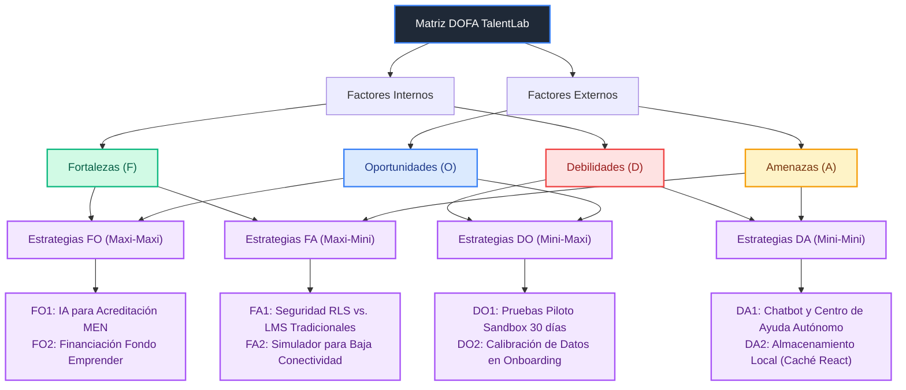
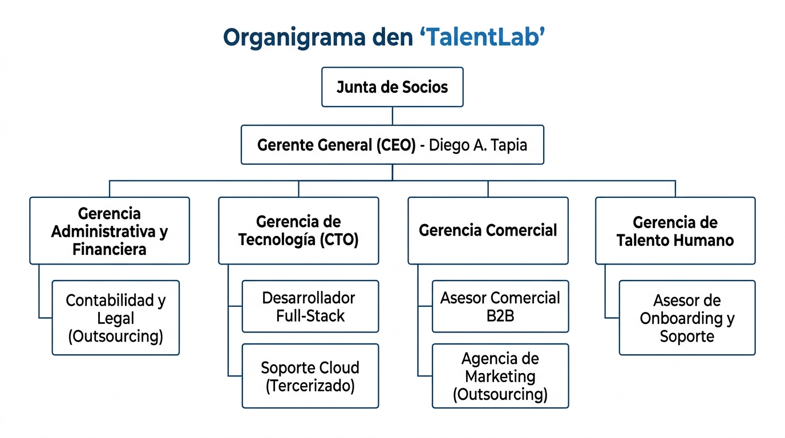
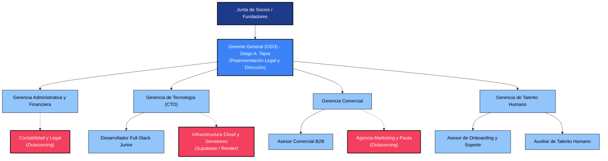

# 4.0. ESTUDIO ORGANIZACIONAL

El análisis de viabilidad de un negocio digital requiere establecer una estructura administrativa clara que responda de manera directa a las necesidades operativas del proyecto. En **TalentLab**, la determinación de las áreas funcionales (Dirección General, Desarrollo Tecnológico, Área Comercial y Soporte al Cliente) tiene como objetivo coordinar los esfuerzos para garantizar la puesta en marcha de la plataforma SaaS y asegurar su sostenibilidad financiera y operativa a largo plazo. Esta sección detalla la definición de la identidad corporativa y el análisis estratégico del entorno de nuestra organización.

---

## 4.1. MISIÓN Y VISIÓN

La identidad de marca y el propósito estratégico de TalentLab se fundamentan en las siguientes declaraciones organizacionales:

### 4.1.1. Misión
Somos una plataforma tecnológica dedicada a transformar el bienestar y el éxito profesional estudiantil en Colombia. Desarrollamos soluciones de software como servicio (SaaS) sustentadas en Inteligencia Artificial y Machine Learning que detectan oportunamente el riesgo de deserción académica, entrenan habilidades laborales prácticas mediante simulaciones interactivas y conectan a los estudiantes con egresados y mentores. Buscamos reducir las brechas de permanencia y empleabilidad educativa con un modelo comercial sostenible y de alto impacto social.

### 4.1.2. Visión
Para el año 2031, posicionarnos como la plataforma EdTech líder en analítica predictiva de retención estudiantil y entrenamiento laboral en la región andina, consolidando una red activa de más de 150 instituciones educativas aliadas y beneficiando a más de 100,000 estudiantes y egresados a través de la democratización de la inteligencia artificial.

---

## 4.2. ANÁLISIS DOFA

Para estructurar la planeación estratégica y evaluar la posición competitiva de TalentLab en el sector EdTech, se ha elaborado una matriz de análisis DOFA cruzada. Esta metodología identifica los factores internos (Fortalezas y Debilidades) y externos (Oportunidades y Amenazas), describe su impacto operativo y define estrategias específicas (Matriz de los 9 cuadrantes) para mitigar amenazas, corregir debilidades, aprovechar oportunidades y potenciar fortalezas.

### 4.2.1. Identificación de Factores e Impacto Estimado

#### 1. Fortalezas (Factores Internos Positivos)
*   **F1. Modelo de IA Predictivo Propio (Random Forest):** Alta exactitud (>88%) en la detección de deserción escolar.
    *   *Impacto Estimado:* Genera confianza técnica ante directivos y reduce la deserción real en las instituciones hasta en un 15%, asegurando la retención del cliente.
*   **F2. Simulador Conversacional Inteligente con PLN:** Entrena competencias de empleabilidad estudiantil de forma ilimitada.
    *   *Impacto Estimado:* Alta ventaja competitiva e interacción activa de estudiantes, justificando el valor de la suscripción anual B2B.
*   **F3. Arquitectura Cloud Escalable y Segura (React + FastAPI + Supabase):** Aislamiento de datos multi-tenant nativo.
    *   *Impacto Estimado:* Tiempos de respuesta óptimos (<200 ms) y alta protección frente a accesos no autorizados a información estudiantil.
*   **F4. Cumplimiento Normativo Habeas Data (Ley 1581 de 2012):** Políticas de Row-Level Security (RLS) en base de datos.
    *   *Impacto Estimado:* Blindaje legal y seguridad jurídica para que las instituciones educativas carguen información de estudiantes sin riesgos de sanciones.
*   **F5. Estructura de Bajos Costos Operativos Marginales:** Uso de tecnologías serverless de pago por uso.
    *   *Impacto Estimado:* Excelente viabilidad financiera que permite un margen bruto operativo por licencia de hasta el 93.1%.
*   **F6. Modelo de Negocio de Acceso Social Gratuito:** Licencia básica gratuita para escuelas públicas vulnerables.
    *   *Impacto Estimado:* Fuerte posicionamiento de responsabilidad social y tracción orgánica de marca en el sector público.

#### 2. Debilidades (Factores Internos Negativos)
*   **D1. Marca Nueva sin Trayectoria Comercial:** Falta de casos de éxito locales documentados.
    *   *Impacto Estimado:* Resistencia inicial a la compra por parte de las juntas directivas educativas tradicionales.
*   **D2. Capacidad Limitada de Soporte Técnico Inicial:** Estructura humana inicial de preventa y soporte pequeña.
    *   *Impacto Estimado:* Riesgo de retraso en la resolución de incidencias complejas si se aceleran las ventas del primer año.
*   **D3. Dependencia de Infraestructura de Terceros (Supabase/OpenAI):** Vulnerabilidad ante caídas del servidor del proveedor o cambios en sus costos.
    *   *Impacto Estimado:* Suspensión temporal de la plataforma o incrementos imprevistos en los costos de insumos digitales por fluctuación del dólar.
*   **D4. Dependencia de Datos Históricos Mock/Simulados:** El modelo requiere datos históricos reales de clientes para su calibración final.
    *   *Impacto Estimado:* Reducción transitoria en la precisión del semáforo predictivo durante las primeras semanas de implantación en un nuevo cliente.

#### 3. Oportunidades (Factores Externos Positivos)
*   **O1. Regulaciones del MEN en Procesos de Acreditación:** Exigencia de evidencias métricas de retención y empleabilidad para Acreditaciones de Alta Calidad.
    *   *Impacto Estimado:* Aceleración de la necesidad institucional de adoptar software predictivo como TalentLab.
*   **O2. Altas Tasas de Deserción en Bogotá:** Índices de deserción técnica que superan el 33% anual.
    *   *Impacto Estimado:* Incremento de los presupuestos institucionales asignados a bienestar para mitigar la pérdida de ingresos por matrículas.
*   **O3. Crecimiento Acelerado del Ecosistema EdTech en LATAM:** Alta adopción de herramientas de educación digital y analítica post-pandemia.
    *   *Impacto Estimado:* Ventana de oportunidad comercial óptima para la captura rápida de leads calificados directivos.
*   **O4. Convocatorias de Cofinanciación Gubernamental (Fondo Emprender):** Disponibilidad de recursos no reembolsables para startups de IA.
    *   *Impacto Estimado:* Financiación del 80% del capital de trabajo y preoperativos iniciales sin endeudamiento.

#### 4. Amenazas (Factores Externos Negativos)
*   **A1. Competidores Directos Consolidados:** Plataformas LMS o SIS que implementen módulos de analítica predictiva de manera nativa.
    *   *Impacto Estimado:* Pérdida de diferenciación comercial y presión a la baja en el precio de la suscripción anual.
*   **A2. Resistencia Cultural al Cambio Tecnológico:** Barreras de adopción en docentes y directivas de la vieja escuela.
    *   *Impacto Estimado:* Baja tasa de uso diario del semáforo, afectando el valor percibido del software y su tasa de renovación.
*   **A3. Variación de Costos Cloud y Dólar en Colombia:** Incremento en el costo de los proveedores en la nube y APIs de IA facturadas en USD.
    *   *Impacto Estimado:* Reducción en el margen bruto de utilidad de insumos unitarios.
*   **A4. Brecha Digital en Estudiantes Vulnerables:** Falta de conectividad móvil e insumos de hardware de red en sectores periféricos.
    *   *Impacto Estimado:* Inposibilidad de estudiantes de zonas marginadas para ejecutar el simulador interactivo de entrevistas por voz.

---

### 4.2.2. Estructura Visual del Análisis DOFA Cruzado

El siguiente diagrama de bloques ilustra de manera simplificada cómo interactúan los factores de la matriz DOFA para constituir las estrategias operativas de TalentLab:

### 4.2.3. Matriz DOFA de los 9 Cuadrantes (Estrategias Cruzadas)

A continuación, se presenta la Matriz DOFA estructurada bajo el formato de 9 cuadrantes, cruzando los factores internos y externos de TalentLab para definir las acciones estratégicas (FO, DO, FA, DA) de la empresa:

### 4.2.3. Matriz DOFA de los 9 Cuadrantes (Estrategias Cruzadas)

A continuación, se presenta la Matriz DOFA estructurada bajo el formato de 9 cuadrantes, cruzando los factores internos y externos de TalentLab para definir las acciones estratégicas (FO, DO, FA, DA) de la empresa:

<table style="width:100%; border-collapse:collapse; font-family:Arial, sans-serif; border: 2px solid #000000; font-size:12px; color:#000000;">
  <!-- Fila de Cabecera Principal -->
  <tr>
    <td rowspan="3" style="width:20%; background-color:#93c5fd; color:black; text-align:center; vertical-align:middle; font-weight:bold; font-size:18px; padding:15px; border:2px solid #000000;">
      MATRIZ DOFA  
      Análisis del Entorno
    </td>
    <td colspan="2" style="background-color:#1e3a8a; color:white; text-align:center; font-weight:bold; font-size:14px; padding:8px; border:2px solid #000000;">
      Análisis Interno (Empresa)
    </td>
  </tr>
  
  <!-- Fila de Fortalezas y Debilidades -->
  <tr>
    <td style="width:40%; background-color:#93c5fd; color:black; font-weight:bold; padding:8px; border:2px solid #000000; text-align:center; font-size:13px;">
      Fortalezas (F)
    </td>
    <td style="width:40%; background-color:#93c5fd; color:black; font-weight:bold; padding:8px; border:2px solid #000000; text-align:center; font-size:13px;">
      Debilidades (D)
    </td>
  </tr>
  <tr>
    <td style="vertical-align:top; padding:10px; border:2px solid #000000; background-color:#ffffff;">
      <ul style="margin:0; padding-left:15px; line-height:1.4;">
        <li><b>F1.</b> Modelo IA Random Forest propio (>88% accuracy).</li>
        <li><b>F2.</b> Simulador interactivo de entrevistas con PLN nativo.</li>
        <li><b>F3.</b> Arquitectura multi-tenant y aislamiento lógico.</li>
        <li><b>F4.</b> Bajos costos operativos marginales (serverless).</li>
        <li><b>F5.</b> Cumplimiento nativo Ley 1581 (Habeas Data).</li>
        <li><b>F6.</b> Plan de acceso social gratuito para escuelas públicas.</li>
      </ul>
    </td>
    <td style="vertical-align:top; padding:10px; border:2px solid #000000; background-color:#ffffff;">
      <ul style="margin:0; padding-left:15px; line-height:1.4;">
        <li><b>D1.</b> Marca nueva sin trayectoria ni posicionamiento.</li>
        <li><b>D2.</b> Soporte técnico y atención al cliente inicial limitado.</li>
        <li><b>D3.</b> Dependencia de APIs de terceros (Supabase/OpenAI).</li>
        <li><b>D4.</b> Datos históricos iniciales simulados (mock) para calibración.</li>
      </ul>
    </td>
  </tr>

  <!-- Fila de Oportunidades y Estrategias FO y DO -->
  <tr>
    <td style="background-color:#93c5fd; color:black; font-weight:bold; padding:8px; border:2px solid #000000; text-align:center; font-size:13px;">
      Oportunidades (O)
    </td>
    <td style="background-color:#93c5fd; color:black; font-weight:bold; padding:8px; border:2px solid #000000; text-align:center; font-size:13px;">
      Estrategias FO (Maxi-Maxi)
    </td>
    <td style="background-color:#93c5fd; color:black; font-weight:bold; padding:8px; border:2px solid #000000; text-align:center; font-size:13px;">
      Estrategias DO (Mini-Maxi)
    </td>
  </tr>
  <tr>
    <td style="vertical-align:top; padding:10px; border:2px solid #000000; background-color:#ffffff;">
      <ul style="margin:0; padding-left:15px; line-height:1.4;">
        <li><b>O1.</b> Regulación MEN exige retención para Acreditación.</li>
        <li><b>O2.</b> Deserción técnica y tecnológica superior al 33% en Bogotá.</li>
        <li><b>O3.</b> Crecimiento y adopción EdTech acelerado en LATAM.</li>
        <li><b>O4.</b> Cofinanciación disponible (Fondo Emprender).</li>
      </ul>
    </td>
    <td style="vertical-align:top; padding:10px; border:2px solid #000000; background-color:#ffffff;">
      <ul style="margin:0; padding-left:15px; line-height:1.4;">
        <li><b>FO1 (F1+F2+O1):</b> Promocionar reportes y semáforos de IA para soportar procesos de Acreditación de Alta Calidad ante el MEN.</li>
        <li><b>FO2 (F5+O4):</b> Sustentar alta escalabilidad y margen bruto en convocatorias públicas para asegurar capital de trabajo.</li>
      </ul>
    </td>
    <td style="vertical-align:top; padding:10px; border:2px solid #000000; background-color:#ffffff;">
      <ul style="margin:0; padding-left:15px; line-height:1.4;">
        <li><b>DO1 (D1+O2):</b> Ofrecer pruebas piloto gratuitas ("Sandbox de 30 días") para demostrar efectividad y reducir barreras comerciales de marca nueva.</li>
        <li><b>DO2 (D4+O1):</b> Usar onboarding con datos históricos reales para calibrar el semáforo predictivo de IA.</li>
      </ul>
    </td>
  </tr>

  <!-- Fila de Amenazas y Estrategias FA y DA -->
  <tr>
    <td style="background-color:#93c5fd; color:black; font-weight:bold; padding:8px; border:2px solid #000000; text-align:center; font-size:13px;">
      Amenazas (A)
    </td>
    <td style="background-color:#93c5fd; color:black; font-weight:bold; padding:8px; border:2px solid #000000; text-align:center; font-size:13px;">
      Estrategias FA (Maxi-Mini)
    </td>
    <td style="background-color:#93c5fd; color:black; font-weight:bold; padding:8px; border:2px solid #000000; text-align:center; font-size:13px;">
      Estrategias DA (Mini-Mini)
    </td>
  </tr>
  <tr>
    <td style="vertical-align:top; padding:10px; border:2px solid #000000; background-color:#ffffff;">
      <ul style="margin:0; padding-left:15px; line-height:1.4;">
        <li><b>A1.</b> Competidores consolidados (LMS/SIS) que integren IA.</li>
        <li><b>A2.</b> Resistencia cultural y tecnológica de directivos/docentes.</li>
        <li><b>A3.</b> Fluctuación del dólar y variabilidad de costos cloud.</li>
        <li><b>A4.</b> Brecha digital e inestabilidad de conectividad en alumnos.</li>
      </ul>
    </td>
    <td style="vertical-align:top; padding:10px; border:2px solid #000000; background-color:#ffffff;">
      <ul style="margin:0; padding-left:15px; line-height:1.4;">
        <li><b>FA1 (F3+F4+A1):</b> Posicionar seguridad legal (Habeas Data) y aislamiento RLS frente a competidores LMS tradicionales.</li>
        <li><b>FA2 (F2+A4):</b> Optimizar frontend en React para conexiones lentas y smartphones de gama baja.</li>
      </ul>
    </td>
    <td style="vertical-align:top; padding:10px; border:2px solid #000000; background-color:#ffffff;">
      <ul style="margin:0; padding-left:15px; line-height:1.4;">
        <li><b>DA1 (D2+A2):</b> Habilitar centro de ayuda auto-gestionado y chatbot interactivo para disminuir tickets y educar docentes.</li>
        <li><b>DA2 (D3+A3):</b> Configurar almacenamiento en caché en el cliente React para amortiguar costos de peticiones en dólares.</li>
      </ul>
    </td>
  </tr>
</table>

---

## 4.3. PERFIL DE LOS CARGOS (ESTRUCTURA DE GERENCIAS)

Para la constitución legal y operación estructurada de **TalentLab**, se define una estructura organizacional jerárquica y funcional basada en una **Gerencia General** y cuatro **Gerencias de Área** clave. A continuación, se detallan los perfiles de los líderes de área y los cargos operativos que dependen de ellos:

### 4.3.1. Perfiles de Nivel Directivo y Gerencial

| Cargo / Rol | Nivel de Formación | Experiencia Laboral | Competencias Técnicas | Competencias Comportamentales | Funciones Principales |
| :--- | :--- | :--- | :--- | :--- | :--- |
| **Gerente General (CEO)** *(Diego A. Tapia)* | Tecnólogo en Análisis y Desarrollo de Software (ADSO) con énfasis en Gestión de Proyectos Tecnológicos. | Mínimo 2 años en gestión de proyectos de desarrollo de software y emprendimiento. | • Planificación financiera de startups. • Estructuración contractual B2B. • Metodologías ágiles (Scrum/Lean). | • Liderazgo estratégico. • Negociación comercial de alto nivel. • Visión de negocio. • Comunicación asertiva. | 1. Representación legal e institucional de la empresa. 2. Toma de decisiones de inversión y financieras. 3. Liderar la negociación de licencias con rectores universitarios. 4. Supervisar el cumplimiento general de metas de las gerencias de área. |
| **Gerente de Tecnología (CTO)** *(Director de Área)* | Profesional en Ingeniería de Sistemas, de Software o tecnólogo con especialización afín. | Mínimo 2 años en desarrollo Full-Stack y administración de arquitectura de servidores. | • Programación en React y FastAPI. • Modelamiento de bases de datos PostgreSQL. • Integración de APIs de IA (OpenAI). | • Resolución de problemas complejos. • Pensamiento lógico-analítico. • Gestión de equipos técnicos. • Proactividad. | 1. Diseñar y mantener la arquitectura técnica del SaaS. 2. Definir las políticas de seguridad y protección de datos (Habeas Data). 3. Supervisar el código desarrollado y el control de calidad (QA). 4. Liderar las integraciones de nuevas tecnologías de IA. |
| **Gerente Comercial y de Mercadeo** *(Director de Área)* | Profesional en Mercadeo, Ventas, Ingeniería Comercial o carreras afines. | Mínimo 2 años en ventas de intangibles, servicios de tecnología o soluciones B2B EdTech. | • Gestión de herramientas CRM corporativas. • Diseño de embudos de conversión (Sales Funnels). • Técnicas de venta consultiva corporativa. | • Elocuencia y persuasión comercial. • Orientación al logro y cumplimiento de KPIs. • Empatía consultiva. • Resiliencia. | 1. Crear e implementar el plan estratégico de ventas anual de la startup. 2. Diseñar el pitch comercial de TalentLab. 3. Supervisar y entrenar al equipo de vendedores internos. 4. Gestionar la relación comercial post-venta con instituciones aliadas. |
| **Gerente de Talento Humano** *(Director de Área)* | Profesional en Psicología, Administración de Empresas o Gestión de Talento Humano. | Mínimo 2 años en procesos de reclutamiento (foco perfiles IT/comerciales), clima laboral y SST. | • Reclutamiento y selección de talento IT. • Legislación laboral en Colombia. • Estructuración de planes de onboarding e inducción. | • Mediación y resolución de conflictos. • Alta empatía y escucha activa. • Comunicación asertiva. • Liderazgo colaborativo. | 1. Diseñar y ejecutar planes de selección de personal para desarrolladores y asesores. 2. Liderar el programa de Onboarding institucional. 3. Gestionar la nómina interna y afiliaciones a seguridad social (ARL, EPS, AFP). 4. Diseñar políticas de bienestar y Clima Organizacional. |

### 4.3.2. Perfiles de Nivel Operativo y de Staff (Tercerizados o Internos)

A continuación, se describen en detalle los perfiles de los cargos operativos indispensables para ejecutar el mantenimiento tecnológico, el soporte técnico y de onboarding escolar, la gestión comercial de ventas y el apoyo administrativo de personal:

| Cargo / Rol | Nivel de Formación | Experiencia Laboral | Competencias Técnicas | Competencias Comportamentales | Funciones Principales |
| :--- | :--- | :--- | :--- | :--- | :--- |
| **Asesor Comercial B2B (Vendedor)** | Técnico, Tecnólogo o Profesional en Ventas, Mercadeo, Negocios o áreas afines. | Mínimo 1 año en ventas consultivas de software (SaaS), intangibles o servicios corporativos. | • Manejo de embudos de ventas y CRM. • Técnicas de prospección y prospección en frío B2B. • Habilidad de realizar demos técnicas de producto. | • Habilidad de persuasión oral. • Resiliencia y manejo del rechazo. • Alta empatía comercial. • Orientación a metas de ventas. | 1. Prospectar y contactar colegios y universidades cliente en Bogotá. 2. Ejecutar presentaciones y demostraciones en vivo del software a directores. 3. Hacer seguimiento al embudo de cierres comerciales. 4. Registrar toda la gestión comercial en el CRM de la empresa. |
| **Asesor de Onboarding y Soporte de Nivel 1 (Mesa de Ayuda)** | Técnico o Tecnólogo en Sistemas, Informática, Educación o carreras afines. | Mínimo 6 meses en atención al cliente, mesas de ayuda (Help Desk) o soporte técnico de plataformas. | • Manejo de plataformas de tickets (como Jira o Zendesk). • Consultas SQL básicas y manejo de bases de datos. • Procesos de carga e importación masiva de datos escolares. | • Paciencia y pedagogía educativa. • Escucha activa. • Comunicación asertiva verbal y escrita. • Empatía con usuarios no técnicos. | 1. Cargar y depurar las bases de datos de estudiantes de los clientes. 2. Capacitar a los docentes y rectores en el uso inicial del software. 3. Atender dudas y fallas a través del sistema de soporte. 4. Escalar los bugs de código o caídas de servidores al CTO. |
| **Auxiliar de Talento Humano (Asistente de RRHH)** | Técnico o Tecnólogo en Gestión Humana, Administración de Empresas, Psicología o afines. | Mínimo 6 meses en funciones de asistencia de recursos humanos, reclutamiento o archivo. | • Manejo de plataformas de afiliación social (PILA, ARL, EPS). • Manejo de herramientas de ofimática (Excel/Word). • Registro y control documental de hojas de vida. | • Confidencialidad estricta. • Alto nivel de organización. • Habilidades para relaciones interpersonales. • Orientación al detalle. | 1. Apoyar en el filtro de hojas de vida para desarrolladores y vendedores. 2. Gestionar el proceso de afiliaciones legales a seguridad social y ARL. 3. Coordinar actividades de bienestar laboral y seguridad en el trabajo (SST). 4. Servir de soporte administrativo en la recopilación de datos de nómina. |
| **Desarrollador Full-Stack Junior** | Técnico o Tecnólogo en Desarrollo de Software (ADSO) o estudiante de Ingeniería de Sistemas. | Mínimo 6 meses en proyectos prácticos de desarrollo de software o codificación web. | • Desarrollo en React (JS) y APIs en FastAPI (Python). • Manejo de bases de datos relacionales en la nube (PostgreSQL). • Control de versiones mediante Git/GitHub. | • Pensamiento analítico. • Capacidad de trabajar bajo metodologías ágiles. • Gusto por la investigación técnica. • Autoorganización. | 1. Programar nuevas interfaces y componentes de UI en React. 2. Mantener y expandir endpoints de API en FastAPI bajo guía del CTO. 3. Realizar pruebas del sistema (QA) y corrección de bugs menores. 4. Documentar los cambios en el repositorio de código. |
| **Contador Externo / Asesor Jurídico (Outsourcing)** | Profesional graduado en Contaduría Pública con tarjeta profesional vigente. | Mínimo 2 años en contabilidad tributaria, laboral y comercial en Colombia. | • Normativa contable NIIF colombiana. • Liquidación de nóminas, aportes de ARL y parafiscales. • Declaración de impuestos nacionales y municipales (DIAN, ICA). | • Rigurosidad profesional. • Ética y confiabilidad corporativa. • Atención al detalle. • Capacidad de análisis financiero. | 1. Diligenciar e inscribir la S.A.S. ante la Cámara de Comercio. 2. Llevar la contabilidad mensual y presentar balances oficiales. 3. Liquidar la nómina mensual y generar los aportes de seguridad social. 4. Asesorar al CEO en regulaciones de Habeas Data y contratos mercantiles. |

---

## 4.4. ÁREAS FUNCIONALES DE LA EMPRESA Y OUTSOURCING

La operación de TalentLab se divide en cuatro grandes Gerencias de área, apoyadas por servicios especializados tercerizados para maximizar la eficiencia operativa y reducir costos fijos de nómina en la etapa preoperativa:

### 4.4.1. Gerencia Administrativa y Financiera (Área de Administración)
*   **Responsabilidades de la Gerencia:** Control financiero general, presupuestos de servidores, y facturación recurrente.
*   **Cargos y Tercerizaciones asociadas:**
    *   *Gerente General (CEO):* Controla el presupuesto financiero y ejecuta las transferencias de nómina y seguridad social.
    *   *Contaduría y Asesoría Legal (Outsourcing Externo):* Se subcontrata una firma externa encargada del procesamiento contable, auditoría jurídica, liquidaciones mensuales de salarios y presentación de impuestos (DIAN).
*   **Justificación:** Se separa la ejecución del dinero (Gerencia General) del cálculo tributario e impositivo (Outsourcing), disminuyendo el riesgo contable y de nómina.

### 4.4.2. Gerencia de Tecnología (Área de Producción)
*   **Responsabilidades de la Gerencia (CTO):** Diseño de la arquitectura de la plataforma, control del código fuente, seguridad e integración de la IA de aprendizaje automático.
*   **Cargos y Tercerizaciones asociadas:**
    *   *Gerente de Tecnología (CTO):* Supervisa el desarrollo de software.
    *   *Desarrollador Full-Stack Junior:* Cargo contratado de manera interna bajo nómina laboral.
    *   *Mantenimiento de Servidores y Cloud (Outsourcing de Infraestructura):* Tercerizado a Supabase (base de datos relacional y seguridad RLS) y Render (servidores de API).
*   **Justificación:** Mantiene al equipo enfocado en el desarrollo del producto mientras la infraestructura de redes física y bases de datos es operada y respaldada de forma remota por proveedores líderes cloud.

### 4.4.3. Gerencia Comercial (Área de Ventas y Mercadeo)
*   **Responsabilidades de la Gerencia:** Captación de nuevos contratos educativos, demostraciones de producto y posicionamiento de marca.
*   **Cargos y Tercerizaciones asociadas:**
    *   *Gerente Comercial:* Lidera las estrategias y pitch comerciales de cierre B2B.
    *   *Asesor Comercial B2B:* Ejecutivo interno contratado por comisión para captación de leads escolares.
    *   *Agencia de Marketing Digital (Outsourcing Externo):* Subcontratada para el desarrollo de pauta digital pago por clic (Google y LinkedIn Ads) y diseño gráfico publicitario.
*   **Justificación:** El cierre de ventas educativas (B2B de alto ticket) requiere personal interno de confianza, pero la atracción de clientes a nivel digital se delega a expertos externos por entregables.

### 4.4.4. Gerencia de Talento Humano (Área de Recursos Humanos y Servicio)
*   **Responsabilidades de la Gerencia:** Reclutamiento de personal técnico/comercial, bienestar laboral, clima interno, capacitación y onboarding de usuarios.
*   **Cargos y Tercerizaciones asociadas:**
    *   *Gerente de Talento Humano:* Planifica la inducción interna de personal y clima laboral.
    *   *Asesor de Onboarding y Soporte de Nivel 1 (Interno):* Encargado del servicio al cliente y capacitación de docentes en colegios clientes.
    *   *Auxiliar de Talento Humano (Interno):* Asistente operativo encargado del soporte administrativo de la gerencia, recopilación de nómina y SST.
*   **Justificación:** El onboarding del cliente (capacitación de docentes en el uso de la IA) y la atención al usuario final son cruciales para evitar la cancelación del software, mientras que el soporte administrativo del personal garantiza una nómina legal ordenada y un ambiente laboral óptimo.

---

## 4.5. ORGANIGRAMA

El organigrama de **TalentLab** ha sido estructurado bajo un enfoque funcional de jerarquía ágil, diseñando líneas claras de mando, comunicación y toma de decisiones. A continuación, se presenta la representación visual de la estructura organizacional que rige la puesta en marcha del proyecto, delimitando los roles internos de nómina y la articulación con los servicios de apoyo y asesoría externa (outsourcing):

### 4.5.1. Estructura Gráfica del Organigrama

### 4.5.2. Representación Esquemática (Líneas de Mando y Articulación)

El siguiente diagrama detalla las relaciones directas (línea continua) y de staff (línea discontinua para outsourcing) del equipo en su fase de lanzamiento:

### 4.5.3. Descripción del Flujo de Comunicación y Autoridad

1.  **Línea Directa de Autoridad (Línea Continua):**
    *   La **Junta de Socios** ejerce la propiedad de la startup y define los lineamientos estratégicos globales.
    *   El **Gerente General (CEO)** reporta a los socios y ejerce la representación jurídica y toma de decisiones financieras, coordinando directamente las cuatro gerencias de área.
    *   Los **Gerentes de Área (Administrativa, Tecnología, Comercial y Talento Humano)** reportan al CEO y son responsables de coordinar sus respectivos departamentos operativos y contratistas externos.
    *   Los cargos de **Desarrollador Junior, Asesor Comercial, Asesor de Onboarding y Auxiliar de Talento Humano** reportan directamente a sus respectivos gerentes de área.

2.  **Relación de Asesoría / Staff (Línea Punteada):**
    *   El **Outsourcing Contable y Legal** reporta a nivel de staff a la Gerencia Administrativa, proveyendo los balances y nóminas, sin tener mando jerárquico interno.
    *   La **Agencia de Marketing Digital (Freelance)** brinda soporte comercial mediante la generación de campañas publicitarias.
    *   Los **Servicios Cloud** son administrados técnicamente por la Gerencia de Tecnología.

---

## 4.6. COSTOS DEL TALENTO HUMANO (PRESUPUESTO DE NÓMINA)

Para garantizar la viabilidad financiera del proyecto y cumplir estrictamente con el marco legal laboral en Colombia, se ha estructurado el presupuesto de costos mensuales de personal. Las estimaciones de nómina se rigen bajo los siguientes lineamientos legales vigentes para el año de operación:

### 4.6.1. Marco Legal del Costeo Laboral en Colombia (Cifras Oficiales 2026)

1.  **Salario Mínimo Legal Mensual Vigente (SMMLV) 2026:**
    De acuerdo con los Decretos 1469 y 1470 del 29 de diciembre de 2025, el SMMLV oficial para el año 2026 en Colombia se fijó en **$1,750,905 COP** mensuales, con un Auxilio de Transporte obligatorio de **$249,095 COP** (Total Ingreso Mínimo de $2,000,000 COP).
2.  **Exención de Aportes Patronales (Artículo 114-1 del Estatuto Tributario):**
    Al constituirse como una persona jurídica (S.A.S.) con empleados que perciben individualmente menos de 10 SMMLV, TalentLab está **exenta** de pagar los aportes patronales correspondientes a Salud (8.5%), SENA (2.0%) e ICBF (3.0%).
3.  **Aportes de Seguridad Social a Cargo del Empleador:**
    *   *Pensión:* 12.0% sobre el salario base mensual.
    *   *ARL (Administración de Riesgos Laborales):* 0.522% sobre el salario base (Clase de Riesgo I, aplicable a actividades administrativas, comerciales y de desarrollo de software en oficina).
4.  **Aportes Parafiscales:**
    *   *Caja de Compensación Familiar (Compensar/Colsubsidio):* 4.0% sobre el salario base.
5.  **Prestaciones Sociales (Provisión Mensual Obligatoria):**
    *   *Prima de Servicios:* 8.33% de la base (salario + auxilio de transporte).
    *   *Cesantías:* 8.33% de la base (salario + auxilio de transporte).
    *   *Intereses sobre Cesantías:* 1.0% mensual (equivalente al 12% anual del valor de las cesantías acumuladas).
    *   *Vacaciones:* 4.17% del salario base (no incluye auxilio de transporte).
6.  **Auxilio de Transporte:**
    *   Se paga obligatoriamente a los trabajadores cuyo salario base sea menor a dos (2) SMMLV (límite de **$3,501,810 COP**). En nuestro caso, aplica para los cargos de Gerente de Talento Humano ($3.5M), Desarrollador Junior ($2.8M), Asesor de Onboarding ($2.2M), Asesor Comercial ($1.75M) y Auxiliar de Talento Humano ($1.75M).

---

### 4.6.2. Matriz Detallada de Costos Mensuales de Personal (COP)

A continuación, se detalla el costo mensual individual para cada cargo de la organización, clasificando los rubros de salario, auxilio de transporte, seguridad social patronal (pensión y ARL), parafiscales (caja de compensación) y provisiones de prestaciones sociales:

| Cargo / Rol | Área | Salario Base | Auxilio Transp. | Seguridad Social | Parafiscales (Caja) | Prestaciones Sociales | Costo Mensual Total |
| :--- | :--- | :---: | :---: | :---: | :---: | :---: | :---: |
| **Gerente General (CEO)** | Administrativa | $6,000,000 | $0 | $751,320 | $240,000 | $1,309,776 | $8,301,096 |
| **Gerente de Tecnología (CTO)** | Tecnología | $5,000,000 | $0 | $626,100 | $200,000 | $1,091,480 | $6,917,580 |
| **Gerente Comercial** | Comercial | $4,000,000 | $0 | $500,880 | $160,000 | $873,184 | $5,534,064 |
| **Gerente de Talento Humano** | Talento Humano | $3,500,000 | $249,095 | $438,270 | $140,000 | $808,025 | $5,135,390 |
| **Desarrollador Full-Stack Junior** | Tecnología | $2,800,000 | $249,095 | $350,616 | $112,000 | $655,218 | $4,166,929 |
| **Asesor Comercial B2B** | Comercial | $1,750,905 | $249,095 | $219,248 | $70,036 | $426,205 | $2,715,489 |
| **Asesor de Onboarding y Soporte** | Talento Humano | $2,200,000 | $249,095 | $275,484 | $88,000 | $524,240 | $3,336,819 |
| **Auxiliar de Talento Humano** | Talento Humano | $1,750,905 | $249,095 | $219,248 | $70,036 | $426,205 | $2,715,489 |
| **Contador Externo / Jurídico** | Administrativa | $800,000 | $0 *(Outsourcing)* | $0 | $0 | $0 | $800,000 |

*Nota 1: El Contador Externo está contratado bajo el esquema de Contrato de Prestación de Servicios (Honorarios), por lo tanto, no devenga auxilio de transporte ni prestaciones sociales por parte de la empresa.*
*Nota 2: El Gerente Comercial y el Asesor Comercial perciben comisiones variables por cumplimiento de metas B2B, las cuales se provisionan sobre las ventas reales y no forman parte del costo laboral fijo mensual mínimo estructurado en esta tabla.*

---

### 4.6.3. Consolidado Presupuestal de Personal por Áreas Operativas

Para facilitar el análisis presupuestal de la empresa, se agrupan los costos totales de personal mensual por áreas funcionales de TalentLab:

1.  **Área Dirección y Administración:** `$9,101,096 COP` (Gerente General y el servicio de Outsourcing Contable/Legal).
2.  **Área de Tecnología y Producción:** `$11,084,509 COP` (Gerente de Tecnología y Desarrollador Full-Stack Junior).
3.  **Área Comercial y de Ventas:** `$8,249,553 COP` (Gerente Comercial y Asesor Comercial B2B).
4.  **Área de Talento Humano y Servicio:** `$11,187,698 COP` (Gerente de Talento Humano, Asesor de Onboarding y Auxiliar de RRHH).

*   **Presupuesto Mensual Total de Personal (Fijo):** `$39,622,857 COP`
*   **Presupuesto Anual Total Proyectado de Personal:** `$475,474,285 COP`

