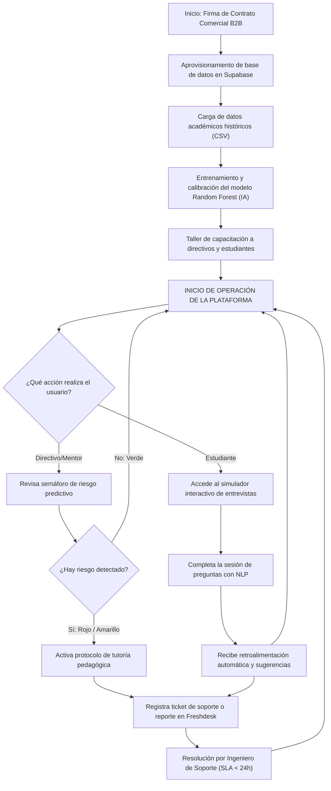

# 3.0 ESTUDIO TÉCNICO

El estudio técnico de **TalentLab** tiene como objetivo determinar las especificaciones de ingeniería del software, los requerimientos de infraestructura y los procesos operativos necesarios para garantizar la prestación estable, segura y eficiente del servicio bajo un modelo de distribución SaaS (Software as a Service) multi-tenant. Esta sección detalla la definición de nuestro Producto Mínimo Viable (MVP) y establece la Ficha Técnica oficial del producto tecnológico.

---

## 3.1. PRODUCTO O SERVICIO MÍNIMO VIABLE (MVP)

Con base en el diagnóstico de la demanda actual y la encuesta aplicada a directivos y estudiantes del sector educativo en Bogotá, se ha delimitado el alcance funcional de la plataforma en su primera fase de comercialización. El Producto Mínimo Viable (MVP) se enfoca en resolver de manera directa dos problemáticas críticas: la deserción estudiantil temprana y las deficiencias de los estudiantes para afrontar entrevistas de trabajo.

El MVP de **TalentLab** consta de dos módulos interactivos principales integrados bajo una arquitectura web escalable y robusta, con seguridad por aislamiento a nivel de base de datos.

### 3.1.1. Módulos Core del MVP

1. **Módulo Semáforo de Deserción Académica (Directivos y Docentes):**
   * **Propósito:** Ofrecer alertas tempranas al personal administrativo y de bienestar estudiantil sobre estudiantes con alta probabilidad de abandonar sus estudios.
   * **Funcionamiento técnico:** Un algoritmo predictivo de clasificación (basado en *Random Forest*) analiza variables de entrada agregadas (tasa de asistencia, promedio académico acumulado, estrato socioeconómico, estado financiero de la matrícula y participación en actividades de tutoría) y categoriza a cada estudiante en tres niveles de riesgo visuales:
     * **Riesgo Alto (Semáforo Rojo):** Probabilidad de deserción > 75%. Requiere intervención prioritaria e inmediata.
     * **Riesgo Medio (Semáforo Amarillo):** Probabilidad entre 40% y 75%. Requiere seguimiento y asignación de tutoría preventiva.
     * **Riesgo Bajo (Semáforo Verde):** Probabilidad < 40%. Estudiante en estado óptimo o bajo control.
   * **Interfaz de Usuario:** Panel directivo responsivo que incluye visualizaciones gráficas del comportamiento de la deserción por cohorte y filtros dinámicos por programa académico.

2. **Módulo Simulador de Entrevistas Laborales con IA (Estudiantes):**
   * **Propósito:** Entrenar y capacitar a los estudiantes para sus primeras interacciones con el mercado laboral real, disminuyendo la brecha de empleabilidad.
   * **Funcionamiento técnico:** Una interfaz interactiva basada en el Procesamiento de Lenguaje Natural (PLN). El simulador plantea preguntas contextualizadas según el área técnica o profesional seleccionada por el estudiante. El usuario responde en tiempo real mediante texto (o transcripción de audio), y el motor de IA analiza semánticamente la coherencia, el uso de terminología técnica y la respuesta.
   * **Retroalimentación instantánea:** Al finalizar la simulación, el sistema retorna:
     * Un puntaje de desempeño global (0 a 100).
     * Un análisis detallado de fortalezas en la respuesta.
     * Acciones puntuales de mejora o respuestas sugeridas de referencia para futuras entrevistas.

### 3.1.2. Matriz de Alineación: Necesidades del Cliente vs. Características del MVP

| Necesidad Detectada en el Mercado | Módulo / Característica del MVP | Beneficio Directo para la Institución / Estudiante |
| :--- | :--- | :--- |
| **Bajo porcentaje de permanencia** en los primeros semestres académicos de carreras técnicas y profesionales. | Semáforo de riesgo predictivo con alertas en tiempo real. | Identificación a tiempo de estudiantes vulnerables para aplicar planes de contingencia antes de que formalicen su retiro. |
| **Poco personal de bienestar** institucional para realizar seguimiento individual a miles de estudiantes. | Consola centralizada con filtros dinámicos de clasificación de riesgo. | Optimización del tiempo del personal psicopedagógico, dirigiéndose específicamente al grupo de estudiantes en "Riesgo Alto". |
| **Dificultad de los estudiantes para ingresar al mercado laboral** por nerviosismo o mala estructuración de respuestas en entrevistas. | Simulador interactivo de entrevistas con retroalimentación automática basada en IA. | Entrenamiento autónomo e ilimitado para el estudiante, lo que incrementa su tasa de contratación y éxito laboral en procesos de selección. |
| **Falta de indicadores cuantitativos de empleabilidad** exigidos por entes de acreditación del Ministerio de Educación Nacional (MEN). | Reporte histórico de desempeño en simulaciones y estadísticas de preparación de egresados. | Información de soporte y evidencias métricas para sustentar los procesos de Acreditación de Alta Calidad institucional. |

---

## 3.2. FICHA TÉCNICA DEL PRODUCTO O SERVICIO

A continuación, se define formalmente la especificación técnica completa de la plataforma digital **TalentLab v1.0.0**. Este documento unifica en una sola matriz estructurada los requerimientos de ingeniería de software, tecnologías aplicadas, condiciones operativas, normatividad legal e impacto ambiental, sirviendo como el estándar oficial de calidad y desarrollo del proyecto.

### Ficha Técnica Unificada del Sistema (TalentLab v1.0.0)

| Dimensión / Variable | Variable Técnica | Especificación Técnica y Detalle del Prototipo |
| :--- | :--- | :--- |
| **Identificación General** | **Nombre del Producto** | TalentLab — Plataforma Inteligente de Acompañamiento Estudiantil |
| | **Slogan / Tagline** | *Detecta. Prepara. Conecta.* |
| | **Versión del Software** | 1.0.0 (Fase Producto Mínimo Viable - MVP) |
| | **Tipo de Distribución** | Software como Servicio (SaaS) interactivo en la nube. |
| | **Modelo de Monetización** | Suscripción Anual B2B (Licencia multi-tenant para instituciones privadas) y Acceso Social Gratuito para colegios oficiales de bachillerato. |
| | **Actividad Económica** | Clasificación Industrial Internacional Uniforme (CIIU): **6201** (Desarrollo de sistemas informáticos), **6202** (Consultoría informática) y **6311** (Hosting y procesamiento de datos). |
| **Arquitectura de Software** | **Modelo Arquitectónico** | Cliente-Servidor desacoplada. Frontend SPA (Single Page Application) que consume una API RESTful centralizada, con aislamiento multi-tenant lógico. |
| | **Lenguajes de Programación** | **JavaScript (ES6+)** para la capa de presentación (Frontend), **Python (v3.11.4)** para la lógica de negocio y APIs (Backend), y **SQL (PostgreSQL v15)** para la base de datos relacional. |
| | **Framework Frontend & UI** | **React.js (v18.2.0)** compilado con **Vite (v5.x)**. Ruteo con **React Router DOM (v6.x)**. Estilos desarrollados en **CSS3 Vanilla** mediante variables globales (Modo Oscuro, Glassmorphism, fuentes Google Fonts: Inter y Outfit). |
| | **Framework Backend & Servidor**| **FastAPI (v0.100.0)** para el desarrollo de la API con tipado estático por **Pydantic (v2)**. Servidor ASGI **Uvicorn (v0.22.0)** para la ejecución y enrutamiento de peticiones. |
| | **Base de Datos & Auth** | **Supabase (PostgreSQL v15)**. Gestión de usuarios y sesiones vía **Supabase Auth** usando **JWT (JSON Web Tokens)** con tiempo de expiración de 1 hora. Aislamiento de datos con **RLS (Row-Level Security)**. |
| | **Algoritmos de IA y ML** | **Semáforo de Deserción:** **Scikit-learn (v1.3.0)** ejecutando el algoritmo supervisado *Random Forest Classifier*. **Simulador de Entrevistas:** Procesamiento de Lenguaje Natural (PLN) utilizando **NLTK (v3.8.1)** o **spaCy (v3.6.0)** para análisis de coherencia semántica. |
| **Requisitos del Cliente** | **Navegadores Soportados** | **Google Chrome** (v100+), **Mozilla Firefox** (v100+), **Microsoft Edge** (v100+) y **Apple Safari** (v15+). Se requiere versión estable y actualizada con soporte HTML5. |
| | **Velocidad de Internet** | *Mínima requerida:* 5 Mbps de bajada / 2 Mbps de subida (ancho de banda básico). *Óptima recomendada:* 10 Mbps de bajada en adelante para transmisiones estables de audio y reconocimiento de voz en el simulador. |
| | **Hardware Mínimo (Usuario)** | Computador de escritorio o portátil con procesador Dual-Core a 1.8 GHz (Intel Core i3 / AMD Ryzen 3), memoria RAM mínima de 4 GB, pantalla con resolución mínima de 1280x720 px. |
| | **Periféricos Requeridos** | Teclado físico o táctil, monitor y **micrófono funcional** (integrado o externo) con permisos habilitados en el navegador para la captura de respuestas de voz en el simulador. |
| **Logística e Infraestructura**| **Empaque y Embalaje** | No aplica empaque físico. Distribución y entrega 100% digital a través de acceso web seguro por protocolo HTTPS (`https://app.talentlab.co` o subdominios autorizados). |
| | **Almacenamiento Cloud** | Cuota de almacenamiento de **50 GB por institución educativa (tenant)** en *Supabase Storage* para el resguardo de históricos, logs y registros de entrevistas. |
| | **Copias de Seguridad (Backup)**| Backups automáticos diarios de la base de datos relacional con una política de retención histórica de 30 días calendario y redundancia geográfica en la nube. |
| | **Despliegue y CI/CD** | Pipeline de integración y distribución continua automatizado en **GitHub Actions**, desplegando imágenes en contenedores **Docker** sobre infraestructura cloud. |
| **Calidad y Mantenimiento** | **SLA de Disponibilidad** | Garantía de disponibilidad mensual del servicio técnico del **99.9% (Uptime)**, soportado por balanceadores de carga automáticos y alta tolerancia a fallos. |
| | **Precisión de IA** | Exactitud predictiva objetivo (*Accuracy*) superior al **88%** en el modelo de Machine Learning para la prevención de deserción escolar. |
| | **Garantías y Soporte** | Soporte técnico correctivo ante fallos y bugs críticos (SLA de 4 horas hábiles para severidad alta) e instalación de parches y actualizaciones de software automáticas sin cobro adicional. |
| **Seguridad y Marco Legal** | **Protocolos de Cifrado** | Encriptación de datos en tránsito usando **TLS 1.3 (HTTPS)** y cifrado en reposo para bases de datos y archivos multimedia mediante algoritmo **AES-256**. |
| | **Protección de Datos** | Cumplimiento estricto de la **Ley 1581 de 2012 (Habeas Data)** y el Decreto 1377 de 2013 en Colombia. Requiere aceptación de términos y consentimiento expreso del usuario al ingresar. |
| **Sostenibilidad Ambiental**| **Impacto de Infraestructura** | Green Hosting: Alojamiento en centros de datos cloud (AWS/GCP) que operan con certificaciones de uso de **energía 100% renovable** y compensación de carbono. |
| | **Impacto Ecológico Directo** | Cero Papel: Reducción del **98%** en el consumo de papel de las oficinas de bienestar universitario al digitalizar el registro de tutorías, alertas predictivas e informes de egresados. |

---

## 3.3. DESCRIPCIÓN DEL PROCESO

El proceso de producción, implantación y operación de la plataforma SaaS de **TalentLab** está diseñado bajo principios de ingeniería ágil y entrega de servicios digitales en la nube. A continuación, se describen de manera secuencial cada una de las actividades del proceso de cara a las instituciones educativas (B2B) y los estudiantes (B2C), detallando la asignación de recursos humanos, tecnológicos y operativos.

### 3.3.1. Tabla Secuencial de Actividades del Proceso

| Actividad / Fase | Descripción y Procedimiento Operativo | Tiempo Estimado | Cargos Involucrados | Cantidad de Personal | Equipos y Herramientas | Responsabilidad (Propia vs. Tercero) |
| :--- | :--- | :--- | :--- | :---: | :--- | :--- |
| **1. Negociación y Cierre Contractual B2B** | Presentación de la propuesta comercial a la institución, concertación de términos, firma del acuerdo de suscripción anual y firma del acuerdo de confidencialidad para el tratamiento de datos. | 5 días hábiles | Director Comercial / CTO | 1 persona (TalentLab) | Computador portátil, CRM HubSpot, Adobe Sign / DocuSign. | **Propia** |
| **2. Aprovisionamiento técnico del Tenant** | Creación y aislamiento lógico del entorno del cliente en la base de datos Supabase, configuración del subdominio personalizado de acceso (`https://[institucion].talentlab.co`) y habilitación de credenciales para el administrador institucional. | 4 horas hábiles | Director de Tecnología (CTO) | 1 persona (TalentLab) | Consola de Supabase, Docker, Git/GitHub, script de migración SQL. | **Propia** (Soportada en infraestructura cloud de *Supabase* como tercero). |
| **3. Carga Inicial de Datos y Calibración de IA** | Carga de los registros académicos e históricos socioeconómicos de los estudiantes (formato CSV anonimizado) aportados por bienestar estudiantil, y ejecución del script de entrenamiento inicial del modelo *Random Forest* para calibrar el semáforo. | 8 horas hábiles | Analista de Datos / Ingeniero de Preventa | 1 persona (TalentLab) | Jupyter Notebooks, Pandas, Scikit-learn, Google Drive. | **Propia** (Los datos son provistos por el cliente). |
| **4. Onboarding y Capacitación de Usuarios** | Realización de talleres interactivos de capacitación en línea para directores y mentores (uso de dashboards y alertas) y despliegue del manual digital para los estudiantes (uso del simulador de entrevistas). | 2 días hábiles | Ingeniero de Soporte Académico | 1 persona (TalentLab) | Computador portátil, Google Meet o Zoom, guías PDF e infografías. | **Propia** |
| **5. Operación Diaria: Semáforo de Deserción** | Ingesta automatizada de reportes semanales de notas, inasistencias y estados de pagos de la institución. Procesamiento en backend de FastAPI para actualizar el estado del semáforo predictivo (Riesgo Alto, Medio, Bajo). | Continuo (Tiempo de respuesta < 2s) | Módulo de Backend (Automatizado) | 0 personas (Procesamiento automático) | API FastAPI, Servidor Uvicorn, base de datos Supabase, queries SQL. | **Propia** (Monitoreo técnico a cargo de TalentLab). |
| **6. Operación Diaria: Simulador de Entrevistas** | Acceso de estudiantes a la sección del simulador en React, formulación adaptativa de preguntas del banco de datos por área profesional y análisis semántico por Procesamiento de Lenguaje Natural (PLN) para la generación instantánea de feedback. | Continuo (Evaluación en < 3s) | Módulo de IA (Automatizado) | 0 personas (Procesamiento automático) | Frontend React, APIs de procesamiento NLP (Hugging Face / OpenAI). | **Propia** (Consumo y enrutamiento) con APIs provistas por el **Tercero**. |
| **7. Soporte Técnico Postventa (PQRSD)** | Recepción, clasificación y resolución de reportes de bugs, dudas de usuario o fallos de acceso a través del portal de ayuda. Monitoreo del cumplimiento de SLA del 99.9%. | Continuo (Resolución según severidad en < 24h) | Ingeniero de Soporte Técnico | 1 persona (TalentLab) | Freshdesk, Chat de Soporte WhatsApp Business, consola de errores del backend. | **Propia** |

### 3.3.2. Procesos Tercerizados (Outsourcing)

Para optimizar los costos marginales de operación y asegurar una infraestructura de clase mundial, TalentLab delega en proveedores tecnológicos especializados las tareas no nucleares de mantenimiento de hardware físico:
1.  **Hosting y Base de Datos (Supabase / AWS):** El mantenimiento físico del hardware de servidores, la redundancia eléctrica y la climatización de los centros de datos recaen enteramente sobre los proveedores. TalentLab es exclusivamente responsable del diseño lógico, consultas SQL, seguridad a nivel de software y políticas de control de accesos (RLS).
2.  **Motor de Reconocimiento y APIs NLP (Hugging Face / OpenAI):** La infraestructura computacional para procesar y evaluar los modelos grandes de lenguaje en la simulación de entrevistas se terceriza a través del consumo de APIs estables, permitiendo a TalentLab centrarse en la lógica de evaluación pedagógica y el diseño de la interfaz de usuario.

### 3.3.3. Diagrama de Flujo del Proceso

El siguiente diagrama detalla la ruta de flujo operativo, desde la firma del contrato comercial B2B hasta el ciclo continuo de operación y soporte de TalentLab:

---

## 3.4. LOCALIZACIÓN DEL PROYECTO

La localización estratégica de TalentLab está proyectada para aprovechar al máximo las redes de conectividad del ecosistema tecnológico, el talento humano calificado en desarrollo de software y la proximidad con el mercado objetivo comercial.

### 3.4.1. Ubicación Geográfica Propuesta
La empresa establecerá su centro de operaciones administrativas y de ingeniería en la siguiente dirección estratégica:
*   **País:** Colombia
*   **Departamento:** Cundinamarca
*   **Ciudad:** Bogotá D.C.
*   **Localidad:** Chapinero (Zona financiera y de servicios tecnológicos)

### 3.4.2. Justificación de la Localización

1.  **Cercanía al Mercado Objetivo (Demanda):** Bogotá concentra la mayor densidad de instituciones de educación superior privadas y centros de educación técnica y tecnológica de Colombia (más de 120 instituciones activas). La localidad de Chapinero se caracteriza por ser el epicentro de importantes universidades de la ciudad (Universidad Pedagógica Nacional, Universidad Javeriana, Universidad Piloto de Colombia, Politécnico Grancolombiano, Corporación Universitaria de Asturias, entre otras), lo que reduce los costos de desplazamiento comercial para las visitas de preventa presenciales y el relacionamiento cara a cara con rectores y directores de permanencia.
2.  **Acceso a Talento Humano Calificado (Oferta):** Bogotá es el clúster de tecnología y desarrollo de software más grande del país. Esto asegura un flujo continuo de ingenieros de sistemas, desarrolladores frontend/backend y científicos de datos calificados provenientes de instituciones líderes, listos para integrarse al equipo a medida que el software requiera escalar.
3.  **Infraestructura de Conectividad:** La zona elegida cuenta con infraestructuras de telecomunicaciones de fibra óptica redundante de alta disponibilidad, indispensables para las operaciones de despliegue continuo de servidores y las comunicaciones en tiempo real de soporte técnico.

### 3.4.3. Normatividad del Plan de Ordenamiento Territorial (POT) de Bogotá

La operación física de TalentLab se acopla a la normatividad local de planificación urbana, regida bajo el **Decreto 555 de 2021 (Plan de Ordenamiento Territorial - POT de Bogotá "Bogotá Reverdece 2022-2035")**:

*   **Clasificación de Uso del Suelo:** Las actividades de desarrollo de sistemas informáticos, consultoría y procesamiento de datos (actividades CIIU 6201, 6202 y 6311) se encuadran dentro de **Servicios Profesionales de Bajo Impacto** y no residenciales molestos. De acuerdo con el POT, el establecimiento de oficinas administrativas y centros de diseño de software está plenamente permitido en áreas comerciales y zonas de uso mixto.
*   **Impacto Ambiental Urbano:** La sede de la empresa se limitará a oficinas de carácter administrativo, de diseño y reuniones estratégicas, por lo cual **no genera emisiones de ruido, contaminación del aire, residuos peligrosos o vertimientos industriales perjudiciales**. La empresa cumple con creces las normativas de la Secretaría Distrital de Ambiente aplicables a zonas urbanas comerciales.
*   **Estrategia Híbrida de Movilidad y Teletrabajo:** El POT de Bogotá incentiva la descentralización del transporte y el cuidado de la huella ecológica de movilidad. Alineado con esto, TalentLab adoptará una modalidad de **trabajo híbrido (80% teletrabajo / 20% presencial)**. Esto permite operar en una oficina pequeña de 40 metros cuadrados para tareas gerenciales, reduciendo el consumo de energía presencial, los tiempos de desplazamiento de los ingenieros y disminuyendo las emisiones asociadas al transporte urbano de la ciudad.

