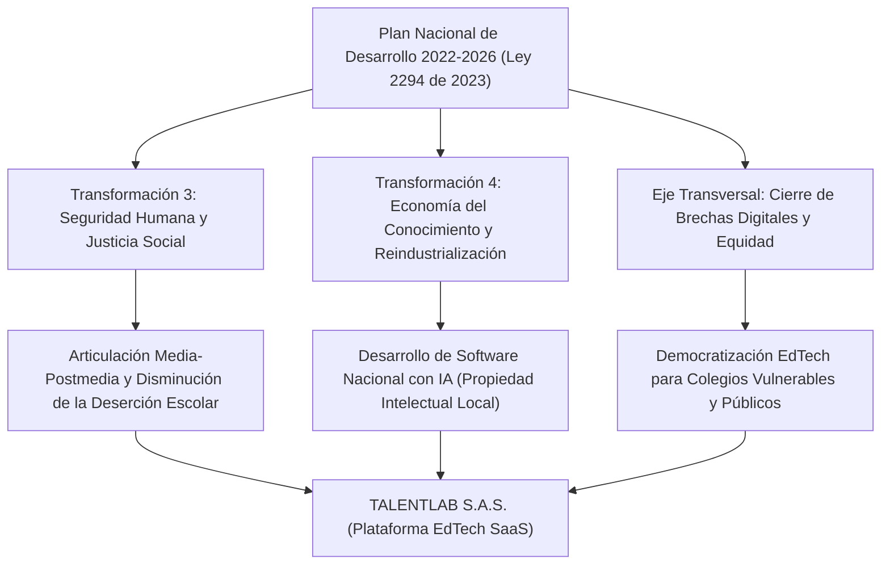
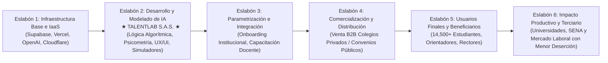
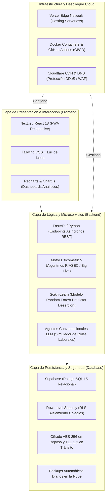

# 7.0. METAS SOCIALES, ECONÓMICAS Y AMBIENTALES

El proyecto **TalentLab S.A.S.**, constituido como una empresa de base tecnológica en el sector EdTech (Software como Servicio - SaaS con Inteligencia Artificial), orienta su modelo productivo no solo a la sostenibilidad financiera y operativa, sino a la generación sistemática de valor público, equidad social, inclusión laboral, preservación del medio ambiente y transferencia tecnológica para Colombia.

A continuación, se exponen de manera rigurosa y fundamentada los compromisos e impactos estratégicos del proyecto en sus dimensiones social, laboral, macroinstitucional, ambiental y tecnológica.

---

## 7.1. METAS SOCIALES

La educación media en Colombia (grados 10° y 11°) enfrenta una profunda problemática estructural vinculada con la desorientación vocacional y la desconexión con el mundo productivo. De acuerdo con las cifras históricas del **Sistema para la Prevención de la Deserción de la Educación Superior (SPADIES)** del Ministerio de Educación Nacional (MEN), entre el 45% y el 48% de los estudiantes que ingresan a programas universitarios o técnicos/tecnológicos desertan en los primeros cuatro semestres, siendo una de las causas directas primordiales la falta de claridad vocacional, el desconocimiento de las propias aptitudes y la escasa alineación con las demandas reales del mercado laboral.

En respuesta a esta realidad, **TalentLab** establece las siguientes metas sociales prioritarias:

### 7.1.1. Metas Sociales Cualitativas
1. **Democratización de la Orientación Vocacional Avanzada:** Romper la brecha de acceso que históricamente ha confinado las evaluaciones psicopedagógicas avanzadas y personalizadas a los colegios privados de élite (estratos 5 y 6), llevando una solución tecnológica accesible a instituciones educativas de estratos 2, 3 y 4 en el sector privado y oficial.
2. **Reducción de la Indecisión Vocacional y Deserción Postmedia:** Empoderar a los estudiantes de últimos años de bachillerato con diagnósticos fundamentados en analítica de datos, autoconocimiento de habilidades blandas y duras, e intereses reales, incrementando en más de un 35% la seguridad en su elección de carrera o formación técnica/tecnológica.
3. **Fortalecimiento de Competencias del Siglo XXI (Habilidades STEAM):** Promover en los jóvenes el pensamiento crítico, la resolución de problemas en entornos reales mediante simulaciones laborales interactivas y la alfabetización digital práctica frente al uso productivo de la Inteligencia Artificial.
4. **Acceso Social para Poblaciones Vulnerables (Modelo de Impacto):** Implementar un programa de responsabilidad social mediante el cual, por cada 10 licencias institucionales privadas suscritas, se entregue acceso gratuito o subsidiado a colegios públicos ubicados en zonas de alta vulnerabilidad socioeconómica o rurales adyacentes a Bogotá y Cundinamarca.

### 7.1.2. Metas Cuantitativas de Impacto Social Proyectadas a 5 Años

| Indicador Social | Año 1 | Año 2 | Año 3 | Año 4 | Año 5 | Meta Acumulada 5 Años |
| :--- | :---: | :---: | :---: | :---: | :---: | :---: |
| **Instituciones Educativas Vinculadas** | 12 | 19 | 31 | 48 | 68 | **68 Colegios Activos** |
| **Estudiantes Evaluados e Impactados** | 1,800 | 3,100 | 5,500 | 9,200 | 14,500 | **34,100 Evaluaciones** |
| **Licencias Sociales Gratuitas Entregadas** | 1 | 2 | 3 | 5 | 7 | **18 Colegios Públicos** |
| **Estudiantes Vulnerables Beneficiados** | 150 | 320 | 540 | 950 | 1,450 | **3,410 Estudiantes** |
| **Talleres Vocacionales y de Empleabilidad** | 24 | 40 | 65 | 100 | 145 | **374 Sesiones Realizadas** |
| **Índice de Certeza Vocacional Percibida** | > 80% | > 82% | > 85% | > 87% | > 90% | **Promedio > 85%** |

*Fuente: Proyección operativa y social de TalentLab S.A.S. con base en la capacidad de escala de la plataforma SaaS.*

---

## 7.2. GENERACIÓN DE EMPLEO

En coherencia con el marco normativo colombiano para el fomento del empleo formal, el emprendimiento y la inclusión social (**Ley 1780 de 2016** de Empleo Joven, **Ley 2069 de 2020** de Emprendimiento, **Ley 82 de 1993** y **Ley 1232 de 2008** sobre Madres Cabeza de Familia, y **Ley 1221 de 2008** reglamentada por la **Ley 2088 de 2021** en materia de Teletrabajo y Trabajo Remoto), TalentLab estructura su política de contratación laboral vinculando grupos poblacionales históricamente priorizados.

### 7.2.1. Caracterización de la Población por Puesto de Trabajo Directo

1. **Dirección General / CEO (Diego Alfonso Tapia Salazar):**
   * *Características Poblacionales:* Joven profesional emprendedor menor de 28 años, egresado/aprendiz del SENA.
   * *Rol y Compromiso:* Liderazgo estratégico, representación legal, gestión de alianzas y dirección general del negocio digital. Constituye generación directa de autoempleo calificado de base tecnológica.

2. **Gerencia de Tecnología e Innovación (CTO / Desarrollador Lead):**
   * *Características Poblacionales:* Joven talento tecnológico nacional (menor de 30 años), graduado de programas de Ingeniería de Sistemas, Software o Computación.
   * *Rol:* Liderazgo del stack tecnológico (FastAPI, React, Supabase), diseño de modelos de Machine Learning y aseguramiento de la infraestructura en la nube.

3. **Gerencia de Operaciones y Pedagogía (Líder Psicopedagógica):**
   * *Características Poblacionales:* **Madre Cabeza de Familia** con formación profesional en Psicología Educativa o Pedagogía, vinculada mediante esquema de trabajo remoto/teletrabajo (80% virtual / 20% presencial).
   * *Justificación e Impacto:* Permite conciliar la crianza y las responsabilidades del hogar con un empleo formal calificado, garantizando estabilidad económica y protección a su núcleo familiar. Lidera la validación psicométrica de los simuladores y el soporte metodológico a orientadores escolares.

4. **Gerencia Comercial y Mercadeo (Líder Comercial / Account Executive):**
   * *Características Poblacionales:* Profesional en Mercadeo, Administración o Negocios Internacionales, priorizando a mujeres jóvenes profesionales o madres trabajadoras con experiencia en ventas B2B institucionales.
   * *Rol:* Prospección institucional, relacionamiento con colegios privados y públicos, demostraciones en vivo y cierre de contratos de suscripción anual.

5. **Desarrollador Junior / Soporte Técnico Nivel 1 (Población Joven Primer Empleo):**
   * *Características Poblacionales:* **Jóvenes Primer Empleo y Egresados SENA** (Tecnólogos en Análisis y Desarrollo de Software - ADSO o afines) de estratos 1, 2 y 3, que carecen de experiencia laboral formal previa.
   * *Justificación e Impacto:* TalentLab abre las puertas a su primera inserción laboral calificada en la industria del software, acogiéndose a los incentivos de la Ley 1780 de 2016 (exención de aportes a Cajas de Compensación durante el primer año) y brindándoles mentoría técnica continua.

6. **Practicantes / Aprendices SENA (Contrato de Aprendizaje):**
   * *Características Poblacionales:* Aprendices del SENA en etapa productiva pertenecientes a programas técnicos y tecnológicos en desarrollo de software, marketing digital y asistencia administrativa.
   * *Compromiso:* Semillero de talento interno con pago de apoyo de sostenimiento equivalente al 100% del SMMLV más afiliación completa a ARL y EPS.

### 7.2.2. Matriz de Vinculación Laboral y Población Beneficiaria

| Cargo / Posición | Tipo de Vinculación | Población Priorizada | Mecanismo Legal / Beneficio Aplicado | Modalidad de Trabajo |
| :--- | :---: | :---: | :---: | :---: |
| **Director General (CEO)** | Laboral Indefinido | Joven Emprendedor SENA | Ley 2069 de 2020 (Emprendimiento) | Híbrida / Presencial |
| **Gerente de Tecnología (CTO)** | Laboral Indefinido | Joven Profesional Tech | Art. 114-1 E.T. (Exoneración Parafiscales) | Híbrida / Remota |
| **Líder Psicopedagógica** | Laboral Indefinido | **Madre Cabeza de Familia** | Ley 1232 de 2008 / Ley 1221 de 2008 (Teletrabajo) | Remota (80%) |
| **Líder Comercial B2B** | Laboral Indefinido | Mujer / Joven Profesional | Art. 114-1 E.T. / Esquema de Comisiones | Híbrida (Terreno) |
| **Desarrollador Jr. / Soporte** | Laboral Término Fijo | **Joven Primer Empleo SENA** | Ley 1780 de 2016 (Primer Empleo Joven) | Remota (100%) |
| **Aprendiz SENA Software** | Contrato Aprendizaje | Aprendiz SENA Etapa Práctica | Ley 789 de 2002 (Contrato de Aprendizaje) | Remota / Híbrida |

---

## 7.3. ARTICULACIÓN CON EL PLAN NACIONAL DE DESARROLLO

El proyecto **TalentLab S.A.S.** se alinea de forma directa y estratégica con los objetivos del **Plan Nacional de Desarrollo 2022-2026 "Colombia, Potencia Mundial de la Vida"** (adoptado mediante la **Ley 2294 de 2023**), enmarcándose dentro de las siguientes transformaciones estructurales:

### 7.3.1. Transformación 3: Seguridad Humana y Justicia Social
* **Universalización y Pertinencia de la Educación:** El PND establece la meta de transformar la educación media, cerrando la brecha entre el colegio y la educación superior o terciaria. TalentLab apoya directamente el objetivo nacional de orientar vocacionalmente a los jóvenes antes de egresar de grado 11, evitando que tomen decisiones a ciegas que desemboquen en deserción o frustración académica.
* **Permanencia en la Educación Postmedia:** Al diagnosticar tempranamente factores de riesgo de deserción y alinear al estudiante con carreras acordes a sus aptitudes socioemocionales e intelectuales, TalentLab contribuye a la meta de elevar la tasa de graduación efectiva en la educación superior y técnica.

### 7.3.2. Transformación 4: Transformación Productiva, Internacionalización y Acción Climática (Economía del Conocimiento y Reindustrialización Digital)
* **Impulso a la Industria Nacional de Software:** El PND prioriza la transición de una economía extractivista a una **economía del conocimiento y de servicios basados en conocimiento (SBC)**. TalentLab es una solución de base tecnológica 100% desarrollada en Colombia, con derechos de autor registrados ante la DNDA, que genera propiedad intelectual nacional en Inteligencia Artificial y no requiere importación de insumos físicos.
* **Estrategia Nacional de Tecnologías de la Información y Conectividad (MinTIC):** Alineado con las metas del Ministerio de las TIC para el fomento de habilidades digitales avanzadas, alfabetización en Inteligencia Artificial y adopción de tecnologías de la Cuarta Revolución Industrial en el sector social y educativo.

---

## 7.4. ARTICULACIÓN CON EL PLAN REGIONAL Y/O LOCAL DE DESARROLLO

En el ámbito regional y distrital, el proyecto se encuentra radicado y opera desde la ciudad de **Bogotá D.C.**, articulándose con el **Plan Distrital de Desarrollo 2024-2027 "Bogotá Camina Segura"** (aprobado mediante el **Acuerdo Distrital 927 de 2024**):

### 7.4.1. Objetivo Estratégico: "Bogotá confía en su potencial" (Educación, Juventud y Empleo)
* **Programas Distritales de Tránsito a la Educación Superior ("Jóvenes a la E" - Agencia Atenea):** La Alcaldía Mayor de Bogotá y la Secretaría de Educación Distrital (SED) priorizan el fortalecimiento de las trayectorias completas de vida de los jóvenes de colegios públicos y privados hacia la formación superior. TalentLab se complementa perfectamente con iniciativas como el programa *"Yo Puedo Ser"* de la SED, ofreciendo una plataforma tecnológica escalable para que los orientadores de las instituciones distritales tengan datos analíticos objetivos sobre las vocaciones de los colegiales.
* **Fortalecimiento de la Educación Media Fortalecida (EMF):** TalentLab actúa como un laboratorio virtual donde los estudiantes simulan roles del sector productivo (desarrollo de software, finanzas, mercadeo, ciencias de la salud, diseño), apoyando las electivas y modalidades técnicas de los colegios de Bogotá y municipios de la Sabana (Cundinamarca).

### 7.4.2. Objetivo Estratégico: "Bogotá confía en su bienestar con una ciudad con oportunidades" (Innovación, Ciencia y Tecnología)
* **Consolidación de Bogotá como Capital Tecnológica y Emprendedora:** El Plan Distrital impulsa la consolidación del **Campus de Ciencia, Tecnología e Innovación (Campus CTI)** y la dinamización del ecosistema de startups EdTech, GovTech y Fintech. TalentLab suma al tejido productivo distrital una microempresa formalizada bajo código CIIU 6201, tributando en Bogotá (ICA régimen ordinario) y generando empleos tecnológicos calificados.

---

## 7.5. CLÚSTER O CADENA PRODUCTIVA

TalentLab se vincula formalmente al sector de servicios tecnológicos de valor agregado, interactuando en las siguientes iniciativas de aglomeración productiva:

### 7.5.1. Identificación del Clúster
1. **Iniciativa Clúster de Software y Tecnologías de la Información (TI) de Bogotá - Región:**
   * Liderado por la **Cámara de Comercio de Bogotá (CCB)**, en alianza con MinTIC y las universidades de la capital.
   * TalentLab participa como empresa desarrolladora de soluciones de software aplicativo vertical (EdTech), beneficiándose de las agendas de fortalecimiento en arquitectura cloud, internacionalización, ciberseguridad y ruedas de negocios institucionales.
2. **Ecosistema EdTech Colombia (Fedesoft / Colombia Tech Hub):**
   * Agrupación de empresas de base tecnológica especializadas en innovación para el aprendizaje, analítica institucional y retención estudiantil.

### 7.5.2. Cadena Productiva y Eslabón de Integración
La cadena productiva del software educativo e Inteligencia Artificial se estructura en seis eslabones fundamentales. **TalentLab S.A.S. se integra de forma directa y protagónica en el Eslabón 2 (Diseño, Desarrollo y Ensamble de Soluciones de Software con IA)**, ejerciendo simultáneamente el rol de integrador comercial hacia los eslabones finales:

#### Descripción de la Integración en la Cadena:
* **Entradas (Proveedores):** Consume infraestructura cloud elástica (servicios en la nube serverless, bases de datos relacionales PostgreSQL en Supabase, endpoints de modelos fundacionales de IA) e insumos psicométricos validados científicamente (teoría RIASEC de Holland, factores de personalidad Big Five, inteligencias múltiples de Gardner).
* **Proceso de Valor Agregado (TalentLab):** Transforma estos insumos en una plataforma web integral mediante algoritmos predictivos entrenados localmente, interfaces gamificadas de simulación laboral y dashboards predictivos de deserción para colegios.
* **Salidas (Clientes y Sociedad):** Entrega licencias SaaS anuales B2B a colegios y secretarías de educación, transfiriendo información estratégica a rectores, orientadores escolares, familias y estudiantes.
* **Impacto al Eslabón Final:** Alimenta al sector universitario y al mercado laboral con egresados mejor perfilados, vocacionalmente conscientes y con habilidades blandas comprobadas.

---

## 7.6. IMPACTO AMBIENTAL

El modelo operativo de **TalentLab S.A.S.** corresponde a una industria digital de servicios basados en conocimiento. Debido a la ausencia de procesos fabriles, transformación de materias primas físicas o transporte masivo de mercancías, el proyecto se califica como de **muy bajo impacto ambiental negativo directo**. No obstante, con base en los principios de sostenibilidad corporativa y ecología digital, se han identificado las afectaciones indirectas y las estrategias de mitigación correspondientes.

### 7.6.1. Afectaciones Ambientales del Proyecto y Estrategias de Mitigación

| Componente Ambiental | Afectación Potencial Identificada | Nivel de Riesgo | Estrategia de Mitigación y Control |
| :--- | :--- | :---: | :--- |
| **Energía y Huella de Carbono Digital (Scope 2 y 3)** | Consumo de energía eléctrica por procesamiento de servidores cloud y estaciones de trabajo de los desarrolladores. | Bajo | • Alojamiento exclusivo en centros de datos con compromisos de **energía 100% renovable y carbono neutral** (Vercel / Supabase alojados en zonas AWS con certificación ISO 14001 y Net Zero). • Arquitectura de código eficiente (*Green Computing*) que minimiza llamadas innecesarias a APIs y ciclos de procesamiento CPU/GPU en inferencia de IA. |
| **Residuos de Aparatos Eléctricos y Electrónicos (RAEE)** | Obsolescencia y descarte inadecuado de computadores portátiles, monitores, baterías y periféricos al cumplir su ciclo de vida útil (3 a 5 años). | Medio | • Cumplimiento riguroso de la **Ley 1672 de 2013** (Gestión de RAEE). • Prohibición absoluta de arrojar componentes electrónicos a la basura común. • Convenio de entrega a programas posconsumo certificados por el Ministerio de Ambiente en Bogotá (como *EcoCómputo* o *Puntos Verdes Lito*) para su reutilización y desensamble técnico seguro. |
| **Consumo de Papel y Residuos de Oficina** | Uso de papel en contratos comerciales, facturación, reportes vocacionales físicos e insumos de impresión. | Bajo | • Implementación estricta de la política de **"Oficina Cero Papel"** (inspirada en la Directiva Presidencial 04 de 2012). • 100% de la facturación comercial se realiza electrónicamente ante la DIAN. • Contratos con colegios gestionados con firma digital/electrónica. • Reportes vocacionales entregados 100% en formato digital interactivo en la web y PDF descargable con validación mediante código QR. |
| **Residuos Sólidos Convencionales de Sede** | Generación de residuos ordinarios y de cafetería en el coworking/oficina de Chapinero. | Bajo | • Separación integral en la fuente conforme a la **Resolución 2184 de 2019** del MinAmbiente mediante el código nacional de colores (Blanca: aprovechables; Negra: no aprovechables; Verde: orgánicos). • Entrega de reciclables a organizaciones de recicladores de oficio de la localidad. |

### 7.6.2. Buenas Prácticas Ambientales Aplicadas al Proceso

1. **Modalidad de Trabajo Remoto / Híbrido Sostenible:**
   * El esquema operativo (80% remoto / 20% presencial para labores de planeación y comerciales) reduce en más de un 75% los desplazamientos urbanos diarios de los colaboradores, ahorrando combustible, descongestionando el transporte público de Bogotá y evitando la emisión estimada de **más de 1.8 toneladas de $CO_2$ al año**.
2. **Eficiencia Energética en Estaciones de Trabajo:**
   * Adquisición de computadores portátiles con certificación internacional **Energy Star 8.0** y bajo consumo de vatios (TDP optimizado).
   * Protocolo de apagado programado y suspensión automática en tiempos de inactividad, erradicando el consumo pasivo de energía (*standby power* o corriente vampiro).
3. **Adquisiciones Verdes y Sostenibles (*Green Procurement*):**
   * Priorización de periféricos y mobiliario ergonómico fabricados con plásticos reciclados y materiales de alta durabilidad.
   * Erradicación de vasos, cubiertos y platos desechables plásticos de un solo uso en la sede de la empresa, reemplazándolos por vajilla de uso prolongado.
4. **Cultura Ecológica y Alfabetización Digital Sostenible:**
   * Sensibilización a los colegios aliados y a los estudiantes sobre el uso responsable de la nube, fomentando la limpieza de archivos obsoletos y el uso consciente de recursos de cómputo para reducir la huella ambiental colectiva.

---

## 7.7. IMPACTO TECNOLÓGICO

### 7.7.1. Elementos Tecnológicos Requeridos por el Proyecto

Para garantizar una operación ininterrumpida, escalable, multi-tenant y de alta disponibilidad (99.9% uptime SLA) acorde con los estándares de la industria del software, TalentLab requiere e incorpora los siguientes componentes tecnológicos:

#### Detalle de Elementos Requeridos por Proceso Operativo:
1. **Proceso de Evaluación e Interacción del Estudiante:**
   * Plataforma Web Progresiva (**PWA**) compatible con dispositivos móviles, tablets y computadores de gama de entrada, garantizando que colegios con salas de cómputo antiguas puedan ejecutar las pruebas sin demoras ni consumo excesivo de memoria RAM.
2. **Proceso de Procesamiento Analítico y Machine Learning:**
   * Entorno de ejecución en **Python 3.11+ con FastAPI**, integrando algoritmos de clasificación multiclase para asociar patrones de respuestas con perfiles ocupacionales y matrices de habilidades del Marco Nacional de Cualificaciones (MNC).
   * Modelos de Procesamiento de Lenguaje Natural (PLN) para evaluar respuestas abiertas y generar reportes narrativos adaptados a la edad y contexto de cada estudiante.
3. **Proceso de Administración Institucional y Seguridad de Datos:**
   * Base de datos **PostgreSQL en Supabase** con arquitectura de particionamiento lógico (*multi-tenancy*) y reglas **Row-Level Security (RLS)**, garantizando que ningún colegio pueda visualizar la información de estudiantes de otra institución, asegurando el estricto cumplimiento del principio de seguridad de la **Ley 1581 de 2012** (Habeas Data).
4. **Proceso de Operaciones Comerciales y Soporte al Cliente:**
   * Plataforma CRM en la nube (HubSpot Free / Zoho) para trazabilidad de prospectos educativos, servicio de correo electrónico transaccional seguro (Resend / AWS SES) y herramientas de videoconferencia y soporte remoto (Google Meet / Crisp chat).

### 7.7.2. Aportes Tecnológicos del Proyecto a la Cadena Productiva

TalentLab genera una disrupción positiva en el ecosistema educativo colombiano, aportando innovaciones tangibles que modernizan la cadena de valor:

1. **Evolución del Paradigma Analógico al Ecosistema Predictivo en Tiempo Real:**
   * La orientación vocacional tradicional en Colombia se ha basado durante décadas en cuestionarios impresos en fotocopias, que requieren semanas de calificación manual por parte del orientador y cuyos resultados suelen ser estáticos y desactualizados. TalentLab transforma este esquema en un **proceso digital interactivo e inmediato**, entregando resultados en tiempo real y cruzados con la oferta educativa y ocupacional vigente del país.
2. **Analítica Temprana de Alertas de Deserción Escolar para Colegios:**
   * Dota a los directivos docentes y psicorientadores de un **Dashboard de Analítica Predictiva**, que identifica qué porcentaje de estudiantes de los últimos grados manifiesta desorientación crítica, desmotivación o conflicto en su toma de decisiones. Esto permite a las directivas estructurar planes de intervención y acompañamiento focalizado antes de que termine el año escolar, elevando la retención institucional.
3. **Simulación Inmersiva de Roles Laborales Mediante Inteligencia Artificial:**
   * En lugar de simplemente leer una descripción teórica de una profesión, los estudiantes interactúan con **simuladores de casos prácticos**, donde asumen retos cotidianos (por ejemplo, resolver un desafío contable, diseñar un esquema de código, diagnosticar un caso clínico básico o estructurar una campaña de comunicación). Esto aterriza la expectativa del joven frente a la realidad cotidiana de cada carrera.
4. **Transferencia Tecnológica y Reducción de la Brecha Digital en Instituciones Educativas:**
   * La implementación de TalentLab capacita a docentes y orientadores en el uso de herramientas analíticas de software moderno, promoviendo la apropiación de tecnologías de la Cuarta Revolución Industrial (4IR) en la comunidad educativa y preparando a las nuevas generaciones de egresados para integrarse con éxito a la economía digital contemporánea.
